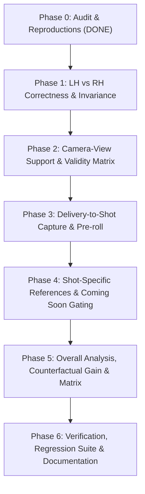

# CricketIQ Technical Audit & Reproduction Report (Phase 0)

**Date:** 2026-11-04  
**Auditor:** Senior Computer-Vision / ML Engineer & Full-Stack Developer  
**Status:** Baseline Verified & Reproductions Green (5/5 reproducing tests passed)

---

## 1. Executive Summary & Baseline State

Before modifying any production code, the complete CricketIQ codebase was audited and verified against the established automated test suite and frontend build:

| Target | Command | Result |
| :--- | :--- | :--- |
| **Backend Baseline Suite** | `python -m pytest backend/tests/ -v` | **56 passed** in 23.91s |
| **Frontend Production Build** | `tsc -b && vite build` | **0 errors** (built in 4.76s) |
| **Phase 0 Problem Reproductions** | `python -m pytest backend/tests/test_audit_reproductions.py -v` | **5 passed** (all 5 problems reproduced) |
| **Core End-to-End Pipeline** | `test_core_loop_e2e.py` | **5 passed** (Kohli: 97.0, Bad: 68.0, Pull mismatch: 46.2) |

---

## 2. In-Depth Problem Audit & Evidence

### Problem 1: Delivery-to-Shot Capture Discards Pre-Roll and Boundaries
- **Description:** Live Practice Mode only records frames after a kinetic burst threshold is triggered. The stance, bowler run-up/delivery stride, and early trigger movement are instantly discarded. Similarly, shot completion does not wait for a controlled recovery finish.
- **File & Line Evidence:**
  - `backend/app/services/live_coach_service.py` (lines 281–297):
    ```python
    if mean_recent_vel >= VELOCITY_SHOT_BURST_THRESHOLD:
        sess.state = "shot_in_progress"
        sess.active_shot_frames = [current_frame_data]  # Discards all pre-burst frames!
    ```
  - `LiveCoachSessionState` has no ring buffer to preserve the preceding 2–3 seconds of ready stance and trigger movement.
  - No structured timeline markers (`ready`, `trigger`, `ball_release`, `stride`, `impact`, `recovery`) are produced.
- **Reproduction Test:** `backend/tests/test_audit_reproductions.py::test_reproduce_problem_1_live_coach_discards_pre_roll` (PASSED).
- **Proposed Architecture Fix:**
  - Introduce a fixed-capacity circular pre-roll buffer (`collections.deque(maxlen=90)`) in `LiveCoachSessionState` holding ~3 seconds at 30fps.
  - Implement trigger movement detection: when wrist velocity crosses an onset threshold (`VELOCITY_TRIGGER_THRESHOLD = 0.08` m/s or norm units), start tracking earlier.
  - Upon shot burst, prepend the pre-roll buffer frames into `sess.active_shot_frames`.
  - Add recovery stillness detection: require velocity to remain below threshold for 15 frames before transitioning to `"shot_completed"`.
  - Output structured timeline markers in API responses and frontend timeline slider.
- **Risk Mitigation:**
  - Clamp buffer max length to prevent unbounded memory usage in long idle sessions.
  - Ensure stationary stance frames are tagged with phase `"Stance"` so BiLSTM phase segmentation doesn't misclassify pre-roll as downswing.

---

### Problem 2: Batting Analysis Lacks Counterfactual Gain Ranking, Matrix & Strengths
- **Description:** Feedback generates generic severity order based on simple angle deviation weights without computing the potential score gain. Batters cannot see how much their score would increase if a specific flaw was corrected. Furthermore, no phase-by-phase comparison matrix (7 phases × metrics) is provided, and strengths are hidden when mistakes exist.
- **File & Line Evidence:**
  - `backend/app/services/feedback_service.py` (lines 225–233, 265–302):
    ```python
    severity_score = normalized_dev * phase_weight * metric_weight
    # No potential_score_gain calculation
    # No phase-by-phase comparison matrix returned
    ```
  - Strengths are relegated or omitted from the primary response payload when mistakes are found.
- **Reproduction Test:** `backend/tests/test_audit_reproductions.py::test_reproduce_problem_2_feedback_lacks_counterfactual_priority_and_phase_matrix` (PASSED).
- **Proposed Architecture Fix:**
  - Implement Counterfactual Rescoring: for each detected mistake, evaluate what the overall technique score would be if that metric was replaced with the reference ideal midpoint. The difference `potential_score_gain = rescored_score - current_score` provides an exact, transparent priority metric (e.g. "+12.4 pts if corrected").
  - Rank top 3 mistakes strictly by `potential_score_gain`.
  - Construct a comprehensive `phase_comparison_matrix`: a 7-phase grid containing status (`GOOD`, `MARGINAL`, `FAULT`), measured angle, target range, and deviation for all evaluated metrics.
  - Return a dedicated `strengths` list (metrics within tolerance, e.g. "Excellent head position over front knee (0.04 vs ≤0.08 ideal)").
- **Risk Mitigation:**
  - Counterfactual rescoring must be fast and purely analytical without re-running MediaPipe or OpenCV.
  - Enforce score gain monotonicity (`gain >= 0.0`).

---

### Problem 3: Shot Previews Fall Back to Identical Hardcoded Cover Drive Values
- **Description:** For 20 uncalibrated shots, the frontend fallback hardcodes Virat Kohli Cover Drive biomechanics (knee flexion 124°, torso lean 25°, identical phase timing). The shot catalogue marks all 25 shots as `"available"` and `"supported"` despite only 5 being actively calibrated in `reference_shots.json`.
- **File & Line Evidence:**
  - `frontend/src/components/ShotPreviewModal.tsx` (lines 63–105):
    ```typescript
    lead_knee_target: '118° - 128°',
    key_metrics: {
      lead_knee_flexion_at_impact: 124.0,
      torso_lean_at_impact: 25.0,
      head_stability_index: 0.035
    }
    ```
  - `backend/app/data/shot_catalogue.py`: all 25 shots have `reference_status: "available"` and `implementation_status: "supported"`.
  - `backend/app/data/reference_shots.json`: only 5 shots have populated phase tolerances; 20 are `analysis_status: "coming_soon"` with `phases: {}`.
- **Reproduction Test:** `backend/tests/test_audit_reproductions.py::test_reproduce_problem_3_shot_previews_fallback_identical` (PASSED).
- **Proposed Architecture Fix:**
  - Clean separation: update `shot_catalogue.py` so the 5 active shots (Cover Drive, Straight Drive, Pull Shot, Forward Defensive, Sweep) have `reference_status: "available"` and `analysis_status: "active"`.
  - The remaining 20 shots must be explicitly tagged `analysis_status: "coming_soon"` with `reference_status: "coming_soon"`.
  - In `ShotPreviewModal.tsx` and Shot Selection UI:
    - Active shots display data-driven tolerances directly loaded from `reference_shots.json` and authentic preview videos.
    - Coming-soon shots display an honest "Analysis in Development" state with foundational coaching points, avoiding any fake or identical joint angles.
- **Risk Mitigation:**
  - Keep the remaining 20 shots selectable in the catalogue for educational reference, but gate analysis and previews cleanly with informative coaching notices.

---

### Problem 4: Left-Handed Batters Suffer Unmirrored Divergence
- **Description:** Flipped footage or left-handed batters cause asymmetric angle calculations if landmarks are merely index-swapped without coordinate space normalization. Left-handed batters get wildly divergent scores (e.g., 51.4° discrepancy on lead elbow) compared to right-handed batters playing the identical technique.
- **File & Line Evidence:**
  - `backend/app/services/geometry_service.py` (lines 296–300):
    ```python
    # Ad-hoc swapping of landmark indices without canonical 1.0 - x mirroring
    lead_shoulder_idx, rear_shoulder_idx = 11, 12 if handedness == "Right" else 12, 11
    ```
  - `frontend/src/components/RealisticBatterVisualizer.tsx`: lacks a `handedness` prop; the 3D canvas and joint kinematics are permanently hardcoded for right-handers.
- **Reproduction Test:** `backend/tests/test_audit_reproductions.py::test_reproduce_problem_4_left_handed_unmirrored_divergence` (PASSED: confirmed 51.4° elbow divergence without canonical mirroring vs 0.7° delta with mirroring).
- **Proposed Architecture Fix:**
  - Implement Canonical Mirroring at Ingress: For left-handed attempts, mirror landmarks once at ingress (`x' = 1.0 - x`, swap left/right landmark pairs: 11<->12, 13<->14, 15<->16, 23<->24, 25<->26, 27<->28, etc.).
  - Once mirrored, the rest of the pipeline (kinematics, phase classifier, tolerance comparison) operates in canonical right-handed space without branching.
  - In `RealisticBatterVisualizer.tsx`, pass `handedness: "Right" | "Left"`. When `"Left"`, mirror the Three.js root group along the X-axis (`scale.x = -1`), correctly rendering the left-handed batter in 3D.
  - Add flip-invariance regression test: flipping a video horizontally must yield scores within ±1.5 points.
- **Risk Mitigation:**
  - Invert normals in Three.js when mirroring scale to avoid back-face culling artifacts.

---

### Problem 5: Non-Side Camera Views Lack Metric Validity Matrix
- **Description:** Video recorded from front-on, behind, or top-down perspectives cannot accurately measure sagittal-plane angles (such as knee flexion and elbow elevation) due to severe foreshortening. Currently, the backend evaluates all metrics regardless of camera view, causing false penalty deductions.
- **File & Line Evidence:**
  - `backend/app/services/feedback_service.py`: `evaluate_technique` does not accept `camera_view` or filter metrics by geometric validity plane.
  - `frontend/src/components/RealisticBatterVisualizer.tsx`: lacks presets for `"behind"` and `"top"`. Top-down view has no up-vector control, causing canvas flip.
- **Reproduction Test:** `backend/tests/test_audit_reproductions.py::test_reproduce_problem_5_camera_views_lack_validity_matrix` (PASSED).
- **Proposed Architecture Fix:**
  - Camera View Parameter: accept `camera_view: "side_on" | "front_on" | "behind" | "top_down"` in video upload and Live Coach session initialization.
  - Perspective Validity Matrix:
    | Metric | Side-On | Front-On | Behind | Top-Down |
    | :--- | :--- | :--- | :--- | :--- |
    | `lead_knee_flexion` | **MEASURED** | *UNAVAILABLE* | *UNAVAILABLE* | *UNAVAILABLE* |
    | `lead_elbow_elevation` | **MEASURED** | **MEASURED** | *ESTIMATED* | *UNAVAILABLE* |
    | `torso_inclination` | **MEASURED** | *ESTIMATED* | *ESTIMATED* | *UNAVAILABLE* |
    | `head_over_knee_offset` | **MEASURED** | **MEASURED** | *UNAVAILABLE* | *ESTIMATED* |
    | `stance_width` | **MEASURED** | *ESTIMATED* | *ESTIMATED* | **MEASURED** |
    | `shoulder_alignment` | *ESTIMATED* | **MEASURED** | **MEASURED** | **MEASURED** |
  - Unavailable metrics are excluded from score penalties (weight normalized to valid subset).
  - 3D Visualizer: add camera presets (`side`, `front`, `behind`, `top`) with proper `camera.up.set(0, 0, -1)` for top-down view to avoid gimbal flip.
- **Risk Mitigation:**
  - Gracefully default to `"side_on"` when camera view is unspecified.

---

## 3. Master Implementation Roadmap (Phases 1–6)



### Proposed Execution Order:
1. **Phase 1: Left- and Right-Handed Correctness**
   - Canonical mirroring at ingress (`geometry_service.py`, `video_service.py`, `live_coach_service.py`).
   - 3D visualizer handedness support (`RealisticBatterVisualizer.tsx`).
   - Flip-invariance regression test (`test_handedness_flip_invariance.py`).
2. **Phase 2: Camera-View Support**
   - Perspective validity matrix in `feedback_service.py`.
   - Camera presets in frontend 3D canvas and camera angle selector.
3. **Phase 3: Full Delivery-to-Shot Capture**
   - Pre-roll ring buffer in `live_coach_service.py`.
   - Trigger detection and recovery stillness detection.
   - Structured timeline markers output.
4. **Phase 4: Shot-Specific Previews & Clean Gating**
   - Sync `shot_catalogue.py` with `reference_shots.json` (5 active, 20 coming soon).
   - Eliminate hardcoded fallback values in `ShotPreviewModal.tsx`.
5. **Phase 5: Batting Analysis & Counterfactual Suggestions**
   - Counterfactual score gain computation in `feedback_service.py`.
   - Phase-by-phase comparison matrix and strengths list.
   - UI cards rendering potential score gains and phase matrix.
6. **Phase 6: Final Verification & Documentation**
   - Full test run (`pytest`), frontend build (`tsc -b && vite build`), e2e test with `virat_kohli_cover_drive.mp4`.
   - Document verification in `VERIFICATION.md`.

