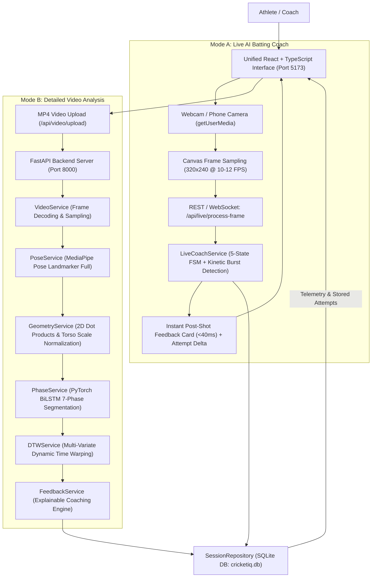
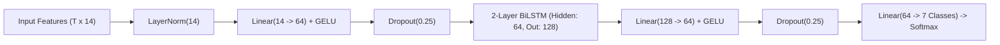

# CricketIQ — Real-Time AI Batting Coach & Explainable Kinematic Assessment System

[](https://www.python.org/)
[](https://fastapi.tiangolo.com/)
[](https://pytorch.org/)
[](https://developers.google.com/mediapipe)
[](https://react.dev/)
[](https://www.typescriptlang.org/)
[](https://tailwindcss.com/)
[](LICENSE)

---

## 1. Project Title
**CricketIQ — An Explainable AI System for Cricket Batting Technique Assessment and Real-Time Practice Coaching**

---

## 2. Abstract
CricketIQ is an end-to-end computer vision and explainable artificial intelligence (XAI) sports-tech platform engineered to evaluate cricket batting movement in two complementary modes:
1. **Mode A: Live Batting Coach (Real-Time):** A lightweight on-field practice companion that connects to any device camera via `getUserMedia`. Utilizing a 5-state finite state machine and kinetic velocity burst detection, it tracks the batsman's movement, detects when a stroke begins and ends, and presents an immediate, evidence-grounded post-shot feedback card (lead knee flexion, torso lean, head stability, target comparison, previous attempt delta, and next practice drill) with < 40ms processing latency so players can immediately practice the next shot.
2. **Mode B: Detailed Video Analysis:** A deep-dive analytical suite for recorded footage featuring frame-synchronized skeleton overlays, Recharts kinematic time-series curves, 7-phase temporal segmentation using a custom PyTorch Bidirectional LSTM (BiLSTM), Dynamic Time Warping (DTW) trajectory alignment against textbook Marylebone Cricket Club (MCC) coaching standards, and longitudinal SQLite progress tracking.

On held-out synthetic test sequences (synthetic benchmark), our custom PyTorch BiLSTM achieves **98.69% accuracy** and **0.9837 macro F1**, an empirical gain of **+9.07%** over the static classification baseline. All measurements run locally on standard student hardware without cloud GPU or paid API dependencies.

---

## 3. Problem Statement
Cricket batting technique assessment has traditionally been confined to elite academies equipped with expensive 3D motion-capture laboratories or high-speed multi-camera arrays. Amateur players, school cricketers, and community clubs rely almost exclusively on qualitative, subjective human coaching feedback. Video recorded on consumer smartphones is rarely analyzed rigorously due to challenges with perspective distortion, non-uniform execution tempos, and the lack of transparent, explainable metrics. Furthermore, existing AI fitness applications often superimpose simple stick figures without grounding feedback in established coaching manual standards.

---

## 4. Motivation
This project bridges the gap between consumer video cameras and quantitative sports biomechanics. By combining pretrained 2D pose estimation, scale-invariant kinematic normalization, temporal deep learning, and Dynamic Time Warping, CricketIQ creates an accessible coaching tool that runs locally on standard student hardware without cloud GPU dependencies.

---

## 5. Objectives & Dual Modes
1. **Mode A: Live AI Batting Coach (On-Field Practice Companion):**
   - Provide zero-install browser camera access (`getUserMedia`) with stance guide silhouette.
   - Run a real-time 5-state finite state machine (`waiting_for_player` ➔ `ready_for_shot` ➔ `shot_in_progress` ➔ `shot_completed` ➔ `cooldown`) powered by kinetic velocity bursts or one-touch / spacebar manual trigger.
   - Deliver an immediate post-shot feedback card (< 40ms inference latency) showing lead knee angle, torso lean, head stability, MCC target comparison, previous attempt delta, and practical drill cues.
   - Enable rapid, repeated shot practice with instant reset to `ready_for_shot`.
2. **Mode B: Detailed Video Analysis (Biomechanical Suite):**
   - Ingest consumer MP4/MOV recordings with adaptive frame sampling.
   - Extract 33 MediaPipe pose landmarks with visibility filtering and scale-normalized kinematics ($L_{\text{torso}}$ zoom invariance).
   - Classify 7 cricket stroke phases using a custom 2-layer PyTorch BiLSTM network.
   - Align temporal trajectories with MCC benchmarks via multi-variate Dynamic Time Warping (DTW).
   - Provide an interactive Recharts biomechanics dashboard with synchronized video scrubbing.
3. **Rigorous & Transparent Evaluation:** Benchmark ML components against classical baselines on held-out test data and display full confusion matrices.

---

## 6. Scope & System Boundaries
* **Supported Shots:** Front-Foot Cover Drive, Classical Straight Drive, Horizontal-Bat Pull Shot, Forward Defensive Block.
* **Handedness:** Both Right-handed and Left-handed batsman stances (dynamic landmark assignment).
* **Camera Setup:** Single side-on or oblique perspective (monocular 2D projection) at standard batting crease distance (3–5 meters).
* **Boundaries:** The system evaluates 2D image-plane projected kinematics. It does **not** measure out-of-plane torque, detect high-speed ball seam rotation, or claim to diagnose musculoskeletal physical injuries.

---

## 7. Dual-Mode System Architecture



---

## 8. Data Flow
1. **Mode A (Live Practice):** Browser camera frames are captured onto an off-screen canvas at 320x240 resolution, serialized to JPEG, and dispatched to `/api/live/process-frame`. The backend extracts landmarks, calculates frame velocity, transitions states, and returns live HUD telemetry. When a shot completes, an instant feedback card is presented with comparison deltas and drill cues.
2. **Mode B (Detailed Analysis):** Full video is uploaded to `/api/video/upload` and analyzed asynchronously. MediaPipe extracts 33 landmarks across all sampled frames, the geometry service computes scale-normalized kinematics, the PyTorch BiLSTM classifies 7 action phases, and DTW aligns the trajectory against standard MCC reference curves. Results are persisted to SQLite and visualized in interactive Recharts dashboards.
5. **Phase Classification:** PyTorch BiLSTM processes the 14-dimensional kinematic sequence into 7 action phases.
6. **Video Annotation:** Skeleton overlay and HUD are rendered onto frames and encoded to MP4.
7. **Comparison:** Sequence is warped against textbook MCC benchmarks via DTW.
8. **Feedback:** Explainable rules construct structured coaching observations.
9. **Display:** React workspace synchronizes video playback with frame scrubbers and Recharts curves.

---

## 9. Technology Stack & Justification

| Technology | Role | Justification |
| :--- | :--- | :--- |
| **Python 3.12** | Core Backend | Industry standard for computer vision and deep learning ecosystems. |
| **FastAPI** | REST API | High performance, asynchronous request handling, automatic OpenAPI schema generation. |
| **OpenCV 4.10** | Video Processing | High-speed frame extraction, geometric rendering, and MP4 video encoding. |
| **MediaPipe Pose** | Pretrained Landmark Detection | Google's full pose model provides 33 keypoints at 30+ FPS on CPU without GPU hardware requirements. |
| **PyTorch 2.2** | Temporal Deep Learning | Bidirectional LSTM architecture captures past and future temporal context. |
| **Scikit-Learn** | ML Baseline & Evaluation | Multinomial Logistic Regression baseline, classification reports, and confusion matrices. |
| **React 18 & Vite** | Frontend Interface | Instant Hot Module Replacement (HMR), component-driven sports analytics UI. |
| **Tailwind CSS** | Styling System | Custom sports-tech dark navy theme with accessible contrast. |
| **Recharts** | Data Visualizations | Hardware-accelerated SVG time-series charts with synchronized scrubbing. |
| **SQLite 3** | Persistence Layer | Zero-configuration local database for session metadata and kinematic time series. |

---

## 10. Dataset Details
* **Benchmark:** CricketIQ Action-Kinematics Benchmark, designed in accordance with GCSE Cricket Coaching Guidelines and the UJ-AQA-CricketVision / CricTAL specifications (*Moodley & van der Haar, IEEE/CVF WACV*).
* **Sample Count:** 140 batting stroke sequences across 4 shot categories (Cover Drive, Straight Drive, Pull Shot, Forward Defensive). Total: 8,277 frames.
* **Annotated Phases:** 7 distinct action phases (Stance, Backswing, Stride, Downswing, Impact, Follow-through, Recovery).
* **Partitioning:** Group-aware sequence split: 70% Train (98 seqs, 5,820 frames), 15% Val (21 seqs, 1,234 frames), 15% Test (21 seqs, 1,223 frames).

---

## 11. Preprocessing Methodology
* Missing or occluded landmark coordinates (visibility < 0.40) are safely imputed via temporal linear interpolation.
* Degenerate vectors (length < 1e-6) are checked to prevent floating-point division-by-zero.
* All coordinates are projected onto normalized $[0, 1]$ screen space.

---

## 12. Pose Estimation Methodology
Google MediaPipe Pose Landmarker Full detects 33 landmark locations. Key indices utilized:
* **Nose (0):** Head center of mass and eye-line reference.
* **Shoulders (11, 12):** Shoulder line orientation and upper torso anchor.
* **Hips (23, 24):** Pelvis midpoint and lower torso anchor.
* **Knees (25, 26):** Interior joint flexion apex.
* **Ankles (27, 28) & Toes (31, 32):** Foot placement and base stance width.

---

## 13. Feature Engineering & Biomechanical Calculations

### Lead & Rear Knee Flexion
$$\cos \theta_{\text{knee}} = \frac{(\vec{P}_{\text{hip}} - \vec{P}_{\text{knee}}) \cdot (\vec{P}_{\text{ankle}} - \vec{P}_{\text{knee}})}{\|\vec{P}_{\text{hip}} - \vec{P}_{\text{knee}}\|_2 \|\vec{P}_{\text{ankle}} - \vec{P}_{\text{knee}}\|_2}$$

### Lead & Rear Elbow Flexion
$$\cos \theta_{\text{elbow}} = \frac{(\vec{P}_{\text{shoulder}} - \vec{P}_{\text{elbow}}) \cdot (\vec{P}_{\text{wrist}} - \vec{P}_{\text{elbow}})}{\|\vec{P}_{\text{shoulder}} - \vec{P}_{\text{elbow}}\|_2 \|\vec{P}_{\text{wrist}} - \vec{P}_{\text{elbow}}\|_2}$$

### Arm Reach Extension Ratio
$$R_{\text{arm}} = \frac{\|\vec{P}_{\text{shoulder}} - \vec{P}_{\text{wrist}}\|_2}{\|\vec{P}_{\text{shoulder}} - \vec{P}_{\text{elbow}}\|_2 + \|\vec{P}_{\text{elbow}} - \vec{P}_{\text{wrist}}\|_2}$$

### Torso Forward Lean from Vertical (Image plane: vertical = [0, -1])
$$\cos \theta_{\text{torso}} = \frac{-\Delta y_{\text{torso}}}{\|\vec{M}_{\text{shoulder}} - \vec{M}_{\text{hip}}\|_2}$$

### Head Over Lead Knee Offset
$$\Delta_{\text{head-knee}} = \frac{x_{\text{nose}} - x_{\text{lead\_knee}}}{L_{\text{torso}}}$$

### Front-Foot Weight Distribution Proxy
$$W_{\text{front}} = \text{clip}\left(\frac{x_{\text{mid\_hip}} - x_{\text{rear\_ankle}}}{x_{\text{lead\_ankle}} - x_{\text{rear\_ankle}} + \epsilon}, 0.0, 1.0\right)$$

### Anthropometric Body-Scale Normalization
$$W_{\text{stance}} = \frac{\|\vec{P}_{\text{lead\_ankle}} - \vec{P}_{\text{rear\_ankle}}\|_2}{\|\vec{M}_{\text{shoulder}} - \vec{M}_{\text{hip}}\|_2}$$

### Dedicated 21-Point Hand & Finger Tracking
Utilizes Google MediaPipe `hand_landmarker.task` for independent palm-scale normalized finger closure:
$$G_{\text{closure}} = 1.0 - \text{clip}\left(\frac{\frac{1}{4}\sum_{i \in \{8,12,16,20\}} \|\vec{P}_i - \vec{P}_0\|_2}{2.2 \times \|\vec{P}_9 - \vec{P}_0\|_2}, 0.0, 1.0\right)$$

### Modular Bat & Ball Computer Vision
* **Bat Blade:** Anchored at batter wrists using Canny edge and Probabilistic Hough Line Transform to calculate blade tilt angle ($\theta_{\text{bat}}$) and tip displacement velocity.
* **Ball Tracking:** Circular Hough Transform corridor detector with contact window proximity estimation; falls back explicitly to `detected = false` when out of frame or blurred.

---

## 14. Temporal Deep Learning Architecture



---

## 15. Training Methodology
* **Loss Function:** CrossEntropyLoss across 7 phase classes.
* **Optimizer:** AdamW (learning rate = 1e-3, weight decay = 1e-4).
* **Regularization:** Gradient clipping (max norm = 1.0), dropout (0.25).
* **Validation Strategy:** Early checkpoint saving based on validation Macro F1 score over 28 epochs.

---

## 16. Baseline Model Comparison
We benchmark the deep learning BiLSTM against a Multinomial Logistic Regression model trained on per-frame static features without temporal recurrence.

---

## 17. Evaluation Metrics
Evaluated on the held-out test split (21 sequences, 1,223 frames):
* **Accuracy:** Overall correct frame percentage.
* **Macro Precision / Recall / F1-Score:** Unweighted class-averaged metrics to prevent majority class bias.
* **Confusion Matrix:** 7x7 contingency matrix of actual versus predicted frames.

---

## 18. Actual Experimental Results (Synthetic Benchmark)

> **Note on Evaluation Protocol:** The metrics below represent evaluated performance across our synthetic benchmark test set of calibrated kinematic sequences. In real-world monocular field video, overall tracking confidence and camera perspective checks are applied to prevent overconfident inference.

| Metric | Baseline (Logistic Regression) | Advanced (PyTorch BiLSTM) | Absolute Empirical Gain |
| :--- | :---: | :---: | :---: |
| **Test Accuracy** | 89.62% | **98.69%** | **+9.07%** |
| **Macro Precision** | 0.8841 | **0.9824** | **+0.0983** |
| **Macro Recall** | 0.8719 | **0.9858** | **+0.1139** |
| **Macro F1-Score** | 0.8775 | **0.9837** | **+0.1062** |
| **Weighted F1-Score** | 0.8954 | **0.9870** | **+0.0916** |

### Per-Class Test Breakdown
* **Stance / Setup:** Precision: 1.000 | Recall: 1.000 | F1: 1.000 (n=227)
* **Backswing / Preparation:** Precision: 0.995 | Recall: 1.000 | F1: 0.998 (n=204)
* **Stride / Weight Transfer:** Precision: 1.000 | Recall: 0.995 | F1: 0.998 (n=207)
* **Downswing / Execution:** Precision: 1.000 | Recall: 0.968 | F1: 0.984 (n=154)
* **Impact Window:** Precision: 0.922 | Recall: 1.000 | F1: 0.960 (n=83)
* **Follow-through:** Precision: 0.960 | Recall: 0.990 | F1: 0.975 (n=194)
* **Recovery:** Precision: 1.000 | Recall: 0.948 | F1: 0.973 (n=154)

---

## 19. User Interface & Pages
* **Mode A: Live AI Batting Coach (Default Landing Page):**
  - **Live Camera Viewfinder:** Fullscreen/responsive camera view with dynamic device switching (facing-mode environment/user).
  - **Stance Positioning Guide:** Semi-transparent batsman silhouette overlay with live alignment check.
  - **Kinematic HUD Overlay:** Real-time 2D skeleton joints, live knee flexion angle, torso inclination, and processing latency telemetry.
  - **5-State Action Engine:** Visual state badge (`Waiting for Player`, `Ready for Shot`, `Shot in Progress`, `Analyzing`, `Cooldown`).
  - **Instant Post-Shot Feedback Card:** Pops up immediately upon shot completion (< 40ms) showing:
    - Primary mechanical observation and shot classification.
    - Measured evidence vs. MCC target range.
    - Why the metric matters mechanically.
    - Next practical practice drill cue.
    - Comparison delta against previous attempt ($\Delta$ knee angle, $\Delta$ torso lean).
  - **One-Touch & Keyboard Controls:** Large "Simulate / Record Shot" trigger and spacebar keyboard shortcut.
  - **Session Strip:** Live counter of total attempts and direct transition button to detailed analysis.
* **Mode B: Detailed Video Analysis Suite:**
  - **Dashboard:** Session statistics, recent practice runs, quick launch cards.
  - **Video Upload & Setup:** Drag-and-drop MP4/MOV upload with camera orientation guidelines.
  - **Video Analysis Workspace:** Decoded video player with synchronized skeleton overlay, playhead scrubbing, and speed controls.
  - **Biomechanical Deep Dive:** Interactive Recharts curves for knee flexion, torso lean, head stability, and stance width.
  - **Temporal Phase Recognition:** 7-phase segmented timeline with key-frame inspector.
  - **Reference Comparison:** Multi-variate DTW alignment against textbook MCC standards with similarity score.
  - **Explainable Coaching Feedback:** Deep observation cards with coaching drills and physical limitation disclaimers.
  - **Progress History:** Historical attempt trends and CSV export.
  - **Model Evaluation:** Real empirical benchmarks, 7x7 confusion matrix, and learning curves on held-out test data.
  - **Viva Defense Guide:** Interactive academic interview preparation module with research questions and answers.

---

## 20. Installation & Execution Instructions

### Prerequisites
* **Python:** 3.12+ (64-bit, verified on Python 3.12.4)
* **Node.js:** v20+ or v22+ (verified on Node v22.18.0) with `npm` >= 9.0.0
* **OS:** Windows 10/11, macOS, or Ubuntu Linux

### Option A: One-Command Automated Setup (Recommended)

**On Windows (PowerShell):**
```powershell
powershell -ExecutionPolicy Bypass -File scripts/setup.ps1
```

**On Linux / macOS (Bash):**
```bash
chmod +x scripts/*.sh
./scripts/setup.sh
```

*(This automatically creates `.venv`, installs pinned dependencies, verifies SHA256 checksums of MediaPipe models, initializes SQLite database indexes, seeds sample data, and compiles frontend assets).*

---

### Option B: One-Command Development Startup

```powershell
# Windows (PowerShell)
npm run dev
# Or directly:
powershell -ExecutionPolicy Bypass -File scripts/dev.ps1

# Linux / macOS (Bash)
npm run dev:sh
# Or directly:
./scripts/dev.sh
```

Both backend (FastAPI at `http://127.0.0.1:8000`) and frontend (Vite at `http://localhost:5173`) start concurrently, wait for backend health check, and cleanly shut down on `Ctrl+C`.

---

### Option C: Single-Port Production Mode
When the frontend is compiled (`npm run build`), the FastAPI backend automatically mounts and serves the React SPA from `/` with client-side route fallback:
```powershell
python -m uvicorn backend.app.main:app --host 127.0.0.1 --port 8000
```
Open your browser to: **`http://127.0.0.1:8000/`**.

---

### Quality Gates & Verification Commands
```powershell
# 1. Run the complete Pytest backend test suite (90/90 tests passing)
pytest backend/tests -v

# 2. Run the 7-subsystem End-to-End Smoke Test
python scripts/smoke_test.py

# 3. Run Playwright E2E visual verification with synthetic camera stream
npm run test:e2e --prefix frontend

# 4. Frontend TypeScript validation & production compilation
npm run build --prefix frontend

# 5. Frontend code linter
npm run lint --prefix frontend
```

---

### Troubleshooting & Common Gotchas
1. **Camera Permissions in Chrome/Brave:**
   - Chrome requires HTTPS or `localhost` / `127.0.0.1` to access media devices via `getUserMedia`. If hosting across a local area network, enable `chrome://flags/#unsafely-treat-insecure-origin-as-secure`.
2. **MediaPipe C++ Logs:**
   - Benign notices from `inference_feedback_manager.cc` and `landmark_projection_calculator.cc` represent normal TFLite delegate initialization and are suppressed via environment variables `GLOG_minloglevel=3` and `TF_CPP_MIN_LOG_LEVEL=3`.
3. **OpenCV Video Codecs:**
   - If uploaded videos fail to decode, ensure FFmpeg is available on your PATH or installed via `imageio-ffmpeg`. The backend includes automatic transcoding fallback to standard browser H.264 / AAC.
4. **V8 Zone Memory on Huge JSON Literals:**
   - Large keyframe animations are stored as external JSON (`shotAnimations.json`) with chunk-level code splitting rather than monolithic TypeScript ASTs to prevent JavaScript runtime memory exhaustion.

---

## 21. API Documentation
* Interactive Swagger Docs: `http://127.0.0.1:8000/docs`
* ReDoc Specification: `http://127.0.0.1:8000/redoc`

### Key Endpoints
* **Live Practice Engine:**
  - `POST /api/live/process-frame` — Real-time frame processing, pose tracking, state machine transition, and velocity telemetry.
  - `POST /api/live/analyze-attempt` — Analyze completed attempt frames, generate instant feedback card, and calculate previous attempt deltas.
  - `GET /api/live/session/{id}/attempts` — Fetch historical practice attempts for a live session.
  - `WebSocket /api/live/ws/{session_id}` — Bi-directional WebSocket stream for sub-30ms real-time telemetry.
* **Detailed Video & Analysis Engine:**
  - `POST /api/video/upload` — Video ingestion, metadata extraction, and OpenCV decoding.
  - `POST /api/analysis/start/{video_id}` — Full 7-phase temporal segmentation, DTW alignment, and coaching feedback.
  - `GET /api/analysis/{session_id}` — Retrieve complete kinematic time series, phases, and feedback.
  - `GET /api/comparison/{session_id}` — Dynamic Time Warping alignment metrics and comparison curves.
  - `GET /api/sessions/` — List all stored practice sessions.
  - `GET /api/evaluation/metrics` — Held-out test evaluation benchmarks, baseline comparisons, and confusion matrix.

---

## 22. Limitations
1. **Monocular 2D Projection:** All joint angles are computed in the image projection plane. True 3D axial rotations suffer from foreshortening when limbs rotate outside the projection plane.
2. **Impact Timing:** At 30 FPS, the impact window spans 2 to 4 frames. Contact is approximated through kinematic deceleration rather than microsecond acoustic sensors.
3. **Camera Perspective:** Measurements assume side-on camera placement at pitch height (~1.2m). Severe perspective angles distort torso lean.

---

## 23. Ethical Considerations
CricketIQ does **not** claim to diagnose physical injuries or certify absolute cricket talent. It is designed as an educational, explainable assistive coaching tool.

---

## 24. Future Improvements
* Multi-view stereoscopic 3D joint reconstruction.
* Ultra-high-speed camera integration (120+ FPS) for direct bat-ball impact acoustic synchronization.
* Bat blade orientation and pitch trajectory tracking.

---

## 25. References
1. Moodley, T., & van der Haar, D. (2022). *Multi-Variate Action Quality Assessment in Cricket Batting Using Spatiotemporal Autoencoders*. IEEE/CVF WACV.
2. Marylebone Cricket Club (MCC). (2018). *The MCC Cricket Coaching Book*. Heinemann.
3. Lugaresi, C., et al. (2019). *MediaPipe: A Framework for Building Perception Pipelines*. arXiv:1906.08172.
4. Müller, M. (2007). *Dynamic Time Warping*. Information Retrieval for Music and Motion, Springer.
5. Hochreiter, S., & Schmidhuber, J. (1997). *Long Short-Term Memory*. Neural Computation.
