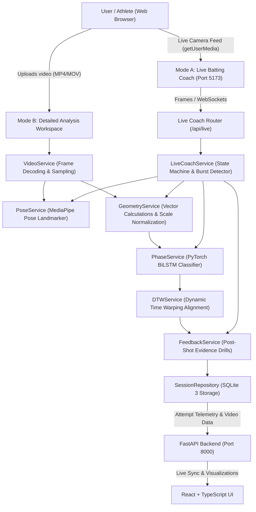
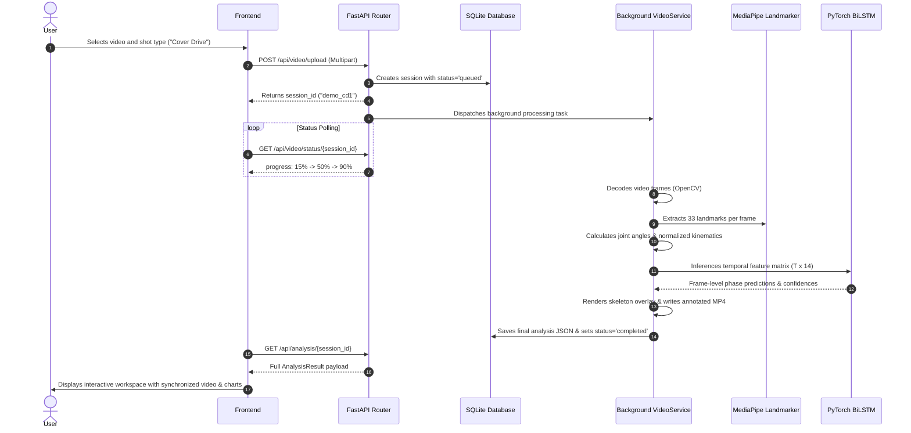

# CricketIQ — System Architecture & Data Flow

## 1. High-Level Architecture

CricketIQ is structured as a decoupled full-stack sports analytics application comprising two complementary modes:
- **Mode A: Live Batting Coach (Real-Time)** — Connects to device camera via `getUserMedia`, runs lightweight pose tracking & state machine, detecting shots in real time and providing concise feedback cards immediately after each shot.
- **Mode B: Detailed Video Analysis (XAI)** — Comprehensive workspace providing skeleton video overlays, Recharts time-series, 7-phase timeline breakdown, Dynamic Time Warping (DTW) reference comparison, and longitudinal progress tracking.

---

## 2. Component Responsibilities

| Component | Technology | Primary Responsibility |
| :--- | :--- | :--- |
| **Frontend UI** | React 18, Vite, TypeScript, Tailwind CSS, Recharts, Lucide | User interaction, video playback with synchronized frame scrubber, interactive kinematic curves, 7x7 confusion matrix visualization, progress tracking |
| **API Layer** | FastAPI, Pydantic v2, Uvicorn | Request validation, asynchronous background processing, video streaming, session persistence endpoints |
| **Pose Estimator** | Google MediaPipe Pose Landmarker Full | Monocular image extraction of 33 human joint coordinates $(x, y, z)$ and visibility confidence |
| **Kinematics Engine** | NumPy, Vector Geometry | Scale-normalized calculations: Lead/rear knee flexion, torso inclination from vertical, head stability, normalized stance width |
| **Temporal Phase Classifier** | PyTorch BiLSTM (2-layer, hidden 64, bidirectional) | Temporal sequence classification into 7 distinct batting action phases (Stance, Backswing, Stride, Downswing, Impact, Follow-through, Recovery) |
| **Sequence Comparator** | Pure NumPy Vectorized DTW | Dynamic Time Warping alignment of multivariate temporal trajectories between player attempts and MCC benchmark standards |
| **Coaching Feedback Engine** | Rule-Based XAI Engine | Evaluates observed metrics against coaching tolerance bands and generates structured, evidence-grounded drill suggestions with technical limitations |
| **Data Persistence** | SQLite | Session metadata, summary metrics, phase boundaries, and frame-level time series |

---

## 3. Asynchronous Video Processing Flow

